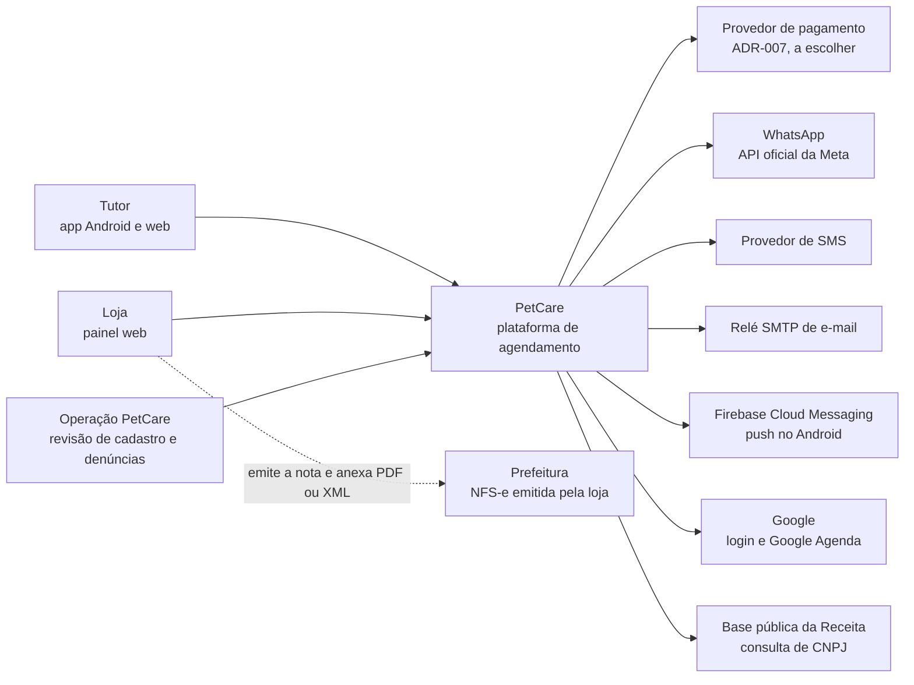
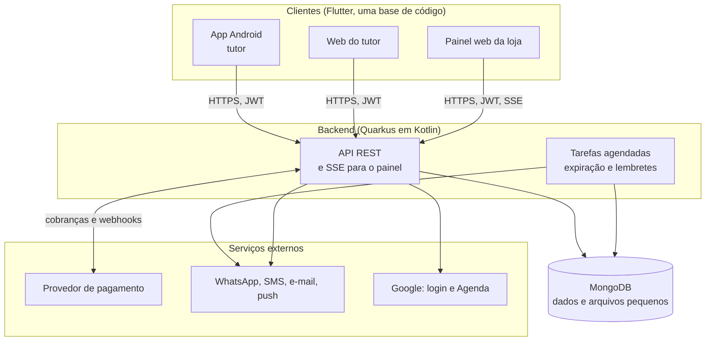
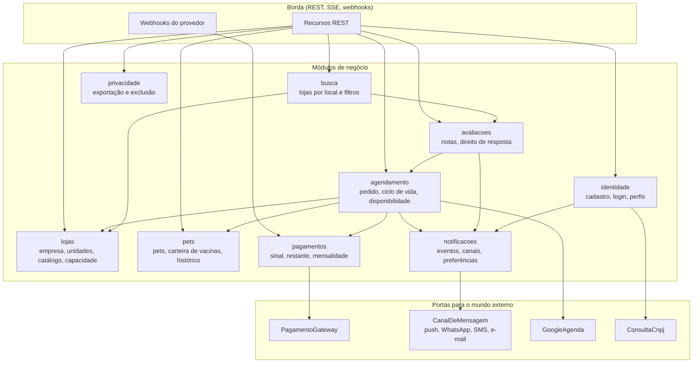
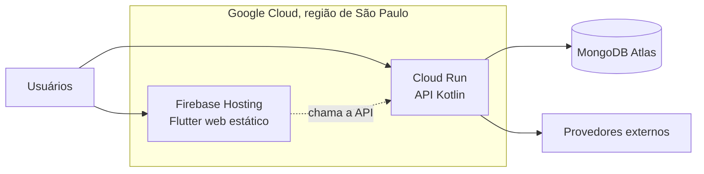

# Arquitetura-alvo (v2.0)

> **Sistema-alvo**, a ser desenvolvido do zero conforme o [Documento Negocial v2.0](../01-negocio/Documento-Negocial-v2.0.md) e o [ADR-006](../08-analise-tecnica/adrs.md#adr-006-flutter-na-web-e-no-mobile-e-kotlin-no-backend-quarkus). A [Arquitetura v1.0](Arquitetura-v1.0.md) continua descrevendo o código atual (MVP de um petshop).
>
> Este documento é **proposta**: nada aqui foi implementado nem testado. Decisões que dependem do PO ou de teste estão marcadas na seção 9.

---

## 1. Visão de solução

Quem usa o sistema e com o que ele conversa.

O PetCare **não recebe o dinheiro dos serviços** (RN-53): a cobrança é criada na conta recebedora de cada loja no provedor de pagamento. A NFS-e é emitida pela loja no sistema da prefeitura; o PetCare só guarda o arquivo (RN-55).

---

## 2. Contêineres

Os blocos que rodam e o que cada um guarda.

| Contêiner | Tecnologia | Responsabilidade |
|---|---|---|
| App Android e web do tutor | Flutter | Busca, agendamento, carteira de vacinas, avaliações. Mesma base do painel |
| Painel web da loja | Flutter web | Pedidos, agenda, catálogo, atendimento, avaliações |
| API | Quarkus 3 + Kotlin, REST, SSE | Regras de negócio, autenticação, webhooks |
| Tarefas agendadas | `quarkus-scheduler` no mesmo processo | Prazo de aceite, lembretes, avaliações pendentes (seção 6) |
| Banco | MongoDB (Panache Kotlin) | Todos os dados; arquivos pequenos (comprovantes, notas) em GridFS |

Não há fila, cache nem serviço de arquivos separados: com 30 lojas e 100 tutores no primeiro ano (RNF-01), o MongoDB e o processo da API bastam. O que faria isso mudar está na seção 8.

---

## 3. Componentes do backend

O backend é um **monólito modular**: um processo, módulos separados por assunto. Cada módulo tem as camadas `dominio`, `aplicacao` e `infra`; um módulo só fala com outro pela interface pública (`aplicacao`), nunca pelo repositório do outro.

### O que cada módulo cobre

| Módulo | Regras de negócio | Observação |
|---|---|---|
| `identidade` | RN-01 a RN-05 | Login com e-mail e senha ou Google; verificação automática de CNPJ; loja com lista de membros pronta para o futuro |
| `lojas` | RN-10 a RN-17 | Loja (CNPJ), unidades, catálogo de serviços, capacidade por tipo de serviço, veterinário com CRMV, inadimplência |
| `pets` | RN-20 a RN-24 | Origem do registro (loja ou tutor), permissão da carteira pelo tutor, lembretes de reforço e de banho |
| `agendamento` | RN-40 a RN-48 | Máquina de estados do pedido, prazo de aceite, reserva atômica de horário |
| `pagamentos` | RN-50 a RN-55 | Sinal e multa definidos pela loja, estorno parcial, restante, mensalidade; guarda só token de cartão (RNF-10) |
| `avaliacoes` | RN-60 a RN-63 | Nota imediata, comentário retido 72 h, avaliação privada do tutor |
| `notificacoes` | RN-70 a RN-72 | Um evento de negócio vira mensagens nos canais escolhidos |
| `busca` | RN-30, RN-31 | Lojas aprovadas e em dia, por localização e filtros |
| `privacidade` | RNF-06 a RNF-08 | Exportação e exclusão de dados, com retenção legal de pagamentos e notas |

### Regras que cruzam os módulos

- **Reserva atômica:** o pedido bloqueia a vaga com uma operação atômica no MongoDB (`findOneAndUpdate` sobre a capacidade do horário), sem "consultar e depois gravar". Isso resolve o débito DT-03 do código atual.
- **Pagamento atrás de uma porta:** `PagamentoGateway` esconde o provedor ([ADR-007](../08-analise-tecnica/adrs.md#adr-007-provedor-de-pagamento)). Os webhooks são a fonte da verdade do estado do pagamento e precisam ser **idempotentes**.
- **Eventos internos:** `agendamento` publica eventos (`PedidoCriado`, `PedidoAceito`, `Cancelado`, entre outros) e `notificacoes` reage a eles. Os eventos são gravados no MongoDB antes do envio (padrão *outbox*), para que uma queda do processo não perca avisos.
- **Erros:** código estável, mensagem e campo no corpo ([ADR-003](../08-analise-tecnica/adrs.md#adr-003-taxonomia-de-erros-da-api)), para o app tratar erros sem depender do texto.

---

## 4. Multi-tenancy

Resumo; a decisão e as alternativas estão no [ADR-008](../08-analise-tecnica/adrs.md#adr-008-isolamento-entre-lojas-multi-tenancy).

- O **tenant é a loja** (empresa, CNPJ). As unidades são parte da loja.
- Um banco só, coleções compartilhadas, e todo documento de uma loja carrega `lojaId`.
- O **tutor não pertence a nenhuma loja**: pets, carteira e histórico são do tutor e a loja só enxerga o que as regras RN-22 e RN-23 permitem.
- O `lojaId` vem do token do usuário, nunca do corpo da requisição.

---

## 5. Implantação (provisória)

A nuvem ainda não está definida (RNF-09). O desenho abaixo é o da [estimativa de custo](Estimativa-Custo-Nuvem-v1.0.md) e serve para dimensionar, não como decisão.

- O app Android é publicado na Google Play e fala direto com a API.
- A API roda com pelo menos uma instância sempre ligada, para cumprir RNF-02 e para os webhooks do provedor chegarem a qualquer hora.
- Ambientes: `local`, `homologacao` e `producao`, conforme o [Manual](../10-git-flow/MANUAL.md). Cada um tem seu próprio banco e suas próprias chaves.

---

## 6. Tarefas agendadas

| Tarefa | Quando | O que faz |
|---|---|---|
| Expirar pedidos | a cada minuto | Pedidos pendentes com prazo vencido viram **Expirado**, devolvem o sinal e avisam o tutor (RN-43, RN-44) |
| Aviso de prazo | a cada 5 minutos | Avisa a loja que o prazo de aceite está perto de vencer |
| Lembrete de horário | a cada 5 minutos | Lembra tutor e loja antes do atendimento |
| Lembrete de vacina e banho | uma vez por dia | RN-24 |
| Publicar comentários | a cada hora | Publica comentários cuja janela de 72 h acabou (RN-61) |
| Inadimplência | uma vez por dia | Tira da busca a loja com mensalidade em atraso (RN-17) |

Com mais de uma instância da API, duas delas não podem rodar a mesma tarefa ao mesmo tempo. A tarefa pega uma **trava no MongoDB** (`findOneAndUpdate` com prazo) antes de rodar.

---

## 7. Segurança e privacidade

- **Autenticação:** JWT RS256 com `kid` ([ADR-005](../08-analise-tecnica/adrs.md#adr-005-kid-no-header-do-jwt-para-rotação-de-chaves)); senha com hash forte; login Google por OIDC.
- **Autorização:** o perfil (tutor ou loja) e o `lojaId` vão no token. Toda consulta de dados de loja filtra por `lojaId` (ADR-008).
- **Pagamento:** o PetCare guarda só o token do cartão. Os webhooks têm a assinatura validada.
- **LGPD:** os dados pessoais ficam em coleções identificáveis, para exportar e apagar por tutor; pagamentos e notas fiscais ficam retidos por 5 anos (RNF-06 a RNF-08).
- **Segredos:** chaves e tokens em variáveis de ambiente do serviço, nunca no repositório.
- **Registro de acesso (auditoria):** quem aceitou, recusou, concluiu e cancelou cada pedido, com data e hora. Entra no modelo de dados.

---

## 8. Riscos e o que revisitar

| Risco | Efeito | Mitigação |
|---|---|---|
| Cloud Run cobrado só por requisição desliga o processador entre requisições | As tarefas agendadas do `quarkus-scheduler` podem não rodar quando ninguém usa o sistema | Cobrança por instância (perfil B da estimativa) ou o Cloud Scheduler chamando um endpoint interno. A estimativa de custo precisa refletir a escolha |
| Reserva de horário sob concorrência | Dois pedidos para a última vaga | Reserva atômica (seção 3) e teste de concorrência |
| Provedor de pagamento sem cobrança direta na conta da loja | RN-53 não se cumpre | Spike em sandbox, depois da fase de documentação (ADR-007) |
| Flutter web: carregamento inicial pesado e SEO fraco | Página pública de busca difícil de achar em buscadores | Decidir no ADR de busca se a vitrine fica fora do app |
| Hospedagem fora do Brasil | Transferência internacional de dados pela LGPD | Preferir região de São Paulo; revisão jurídica |
| Muitos canais de mensagem | Custo de SMS (cerca de 9 vezes o do WhatsApp) | SMS como canal de reserva ou com limite (pendência P-05) |
| Crescimento acima do previsto | Processo único e MongoDB menores que o necessário | Reavaliar fila e cache, separar `notificacoes` em outro serviço, ou fragmentar o banco |

---

## 9. Decisões que faltam

| # | Decisão | Quem | Onde |
|---|---|---|---|
| 1 | ~~Isolamento entre lojas~~: aceito pelo PO em 10/11/2026 | PO | [ADR-008](../08-analise-tecnica/adrs.md#adr-008-isolamento-entre-lojas-multi-tenancy) |
| 2 | Provedor de pagamento | PO, após teste | ADR-007 |
| 3 | ~~Nuvem e região~~: Google Cloud, São Paulo (PO, 10/11/2026) | PO | RNF-09, P-06 |
| 4 | Papel do SMS e valor da mensalidade | PO | P-05 |
| 5 | Arquitetura do app Flutter (estado, navegação, estrutura de pastas) | a documentar | próximo ADR |
| 6 | Vitrine pública fora do Flutter, para buscadores | a decidir | ADR de busca |
| 7 | Linguagem e hospedagem do backend: manter Kotlin no Cloud Run ou avaliar Node na Vercel | PO, após teste de um dia | [Comparativo Kotlin x Node](Comparativo-Kotlin-vs-Node-v1.0.md) |

---

## 10. Próximos documentos

1. ~~Modelo de dados e diagramas de engenharia~~: feitos em [Modelo-de-Dados-v2.0](Modelo-de-Dados-v2.0.md) e [Diagramas-de-Engenharia-v2.0](Diagramas-de-Engenharia-v2.0.md).
2. ~~Contrato da API v2.0~~: feito em [Contrato-API-v2.0](Contrato-API-v2.0.md).
3. ~~Telas e fluxos~~: feitos em [Telas-e-Fluxos](../03-ui-ux/Telas-e-Fluxos-v1.1.md).
4. ~~ADR da arquitetura do app Flutter~~: feito no [ADR-009](../08-analise-tecnica/adrs.md#adr-009-arquitetura-do-app-flutter).
5. ~~Backlog em histórias, definição de pronto e estratégia de testes~~: feitos em [Backlog-v2.0](../04-backlog/Backlog-v2.0.md) e [Definicao-de-Pronto-e-Testes](../04-backlog/Definicao-de-Pronto-e-Testes-v1.0.md).
