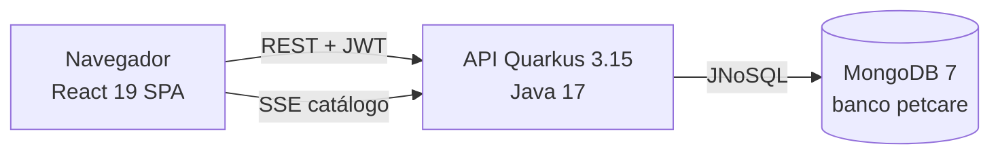

# Arquitetura

> Estado medido no código da branch `develop` em 05/11/2026.

## Visão geral

Monorepo com dois aplicativos independentes e Docker Compose para subir tudo junto.

## Backend (`pet-shop-backend/`)

Clean Architecture em quatro pacotes sob `com.petcare`:

| Pacote | Responsabilidade | Exemplos |
|---|---|---|
| `domain` | Entidades persistidas e enums de valor | `Usuario`, `Pet`, `Servico`, `Agendamento`, `Notificacao`, `AppointmentStatus`, `UserRole`, `ServiceCategory` |
| `application` | Casos de uso e DTOs de entrada e saída | `RegistrationService`, `AuthenticationService`, `PetService`, `AppointmentService`, `ServiceCatalogService`, `NotificationService` |
| `infrastructure` | Adaptadores: REST, persistência, segurança, SSE | `*Controller`, `Mongo*Repository`, `JwtTokenProvider`, `BCryptPasswordEncoder`, `SseCatalogBroadcaster` |
| `shared` | Utilitários | `IdGenerator` |

Os services injetam diretamente os repositórios Mongo, sem interfaces de port ([ADR-001](../08-analise-tecnica/adrs.md#adr-001-services-injetam-os-repositórios-mongo-diretamente)). Erros de negócio saem como `ApiException` com status HTTP, convertidos por `ApiExceptionMapper` e `ValidationExceptionMapper`.

### Principais dependências

`quarkus-rest-jackson`, `quarkus-jnosql-document-mongodb`, `quarkus-smallrye-jwt` (+ `-build`), `quarkus-elytron-security-common` (BCrypt), `quarkus-hibernate-validator`, `quarkus-smallrye-openapi`, `quarkus-smallrye-fault-tolerance` (rate limit do login). Testes com `quarkus-junit5`, `rest-assured` e `mockito-core`.

## Modelo de dados (MongoDB)

| Coleção (entidade) | Campos principais | Observações |
|---|---|---|
| `Usuario` | `id`, `name`, `email`, `phone`, `address`, `passwordHash`, `role`, `businessName`, `petshopId` | `businessName` e `petshopId` só para owner. O petshop não é uma entidade própria: é o owner. |
| `Pet` | `id`, `ownerUserId`, `name`, `species`, `breed`, `age`, `notes` | `ownerUserId` aponta para o tutor |
| `Servico` | `id`, `petshopId`, `name`, `category` (`bath`/`vaccine`), `duration` (texto, ex. "45 min"), `price`, `description`, `features` | Escopado por `petshopId` |
| `Agendamento` | `id`, `userId`, `tutor`, `tutorAddress`, `petshopId`, `petId`, `pet`, `dateTime` (ISO-8601 em texto), `type`, `serviceId`, `service`, `durationMinutes`, `status`, `canceledBy` | Guarda cópias de nome do tutor, endereço e nome do pet |
| `Notificacao` | `id`, `userId`, `petId`, `petshopId`, `appointmentId`, `createdAt`, `title`, `message`, `read` | Gerada quando o petshop cancela |

Status de agendamento: `Agendado`, `Concluido`, `Cancelado` (rótulos em português gravados como texto).

## Segurança

- JWT RS256 assinado com `JWT_PRIVATE_KEY` e validado com `JWT_PUBLIC_KEY` (variáveis de ambiente, nunca versionadas). Expiração padrão de 3600 s (`petcare.jwt.duration`).
- Claims: `sub` (id do usuário), `upn` (e-mail), `groups` (papel), `name`, `role` e `petshopId` (owner). Header com `kid` configurável ([ADR-005](../08-analise-tecnica/adrs.md#adr-005-kid-no-header-do-jwt-para-rotação-de-chaves)).
- Autorização por `@RolesAllowed("tutor" | "owner")`; o escopo do owner vem sempre do `petshopId` do token, nunca do corpo da requisição.
- Login limitado a 5 chamadas por minuto (`@RateLimit`).
- CORS liberado para `http://localhost:5173` em dev e configurado por variável no Compose.

## Tempo real

`SseCatalogBroadcaster` mantém os assinantes por `petshopId`. Quando o owner cria ou remove um serviço, um evento `ADDED` ou `REMOVED` é enviado para `GET /api/servicos/catalogo/stream?petshopId=...`. O frontend consome pelo hook `useCatalogStream`.

## Frontend (`pet-shop-frontend/`)

React 19 + Vite 7 + Tailwind 3 + React Router 7, organizado em Feature-Sliced Design:

| Camada | Conteúdo |
|---|---|
| `app/` | `App.jsx` (rotas), `providers/AuthProvider.jsx` |
| `pages/` | `auth/AuthPage`, `tutor/TutorDashboardPage`, `owner/OwnerDashboardPage` |
| `features/` | `auth`, `pet-management`, `scheduling`, `service-catalog`, `vaccination`, `notifications`, `realtime`, `dashboard/owner` |
| `shared/` | Cliente HTTP, hooks, componentes de UI (`AppShell`, `Field`, `Table`, `StatusBadge`), utilitários de data |

Rotas: `/auth`, `/tutor/*`, `/owner/*`; qualquer outra rota redireciona para `/auth`.

## Infraestrutura

| Arquivo | O que sobe |
|---|---|
| `docker-compose.yml` | MongoDB 7 (27017), backend (8080) e frontend em nginx (8081) |
| `docker-compose.dev.yml` | MongoDB + backend em `mvn quarkus:dev` com código montado + Vite (5173) |
| `pet-shop-backend/Dockerfile` | Build Maven multi-stage, imagem final JRE 17 com layout fast-jar. Testes pulados no build da imagem. |
| `pet-shop-frontend/Dockerfile` | Build Vite e nginx servindo os estáticos |

Não há pipeline de CI nem ambiente publicado. Ver [Débitos técnicos](../08-analise-tecnica/Debitos-Tecnicos-v1.0.md).
