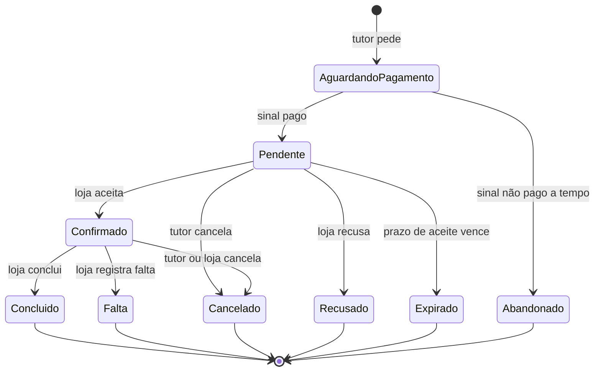
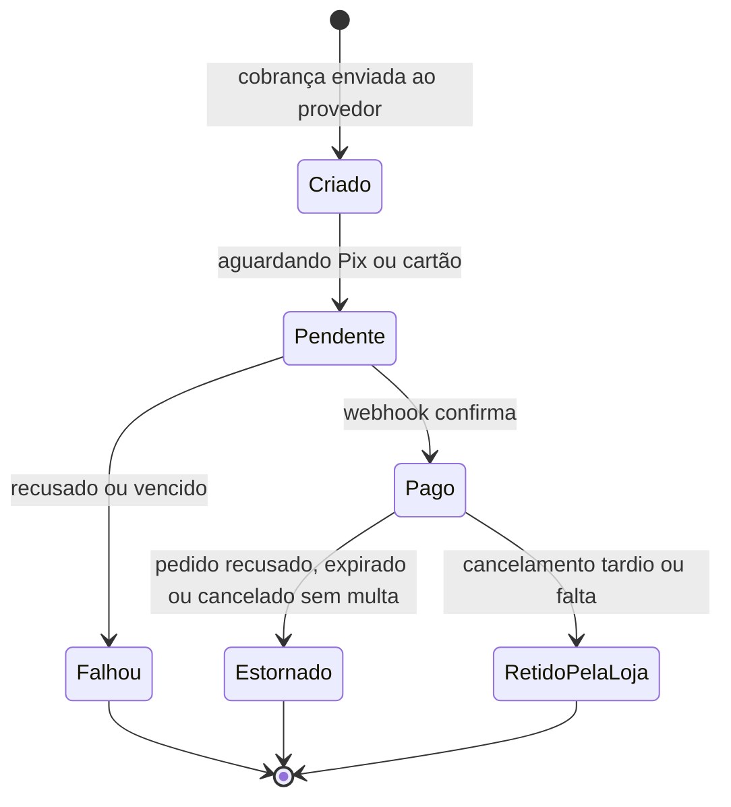
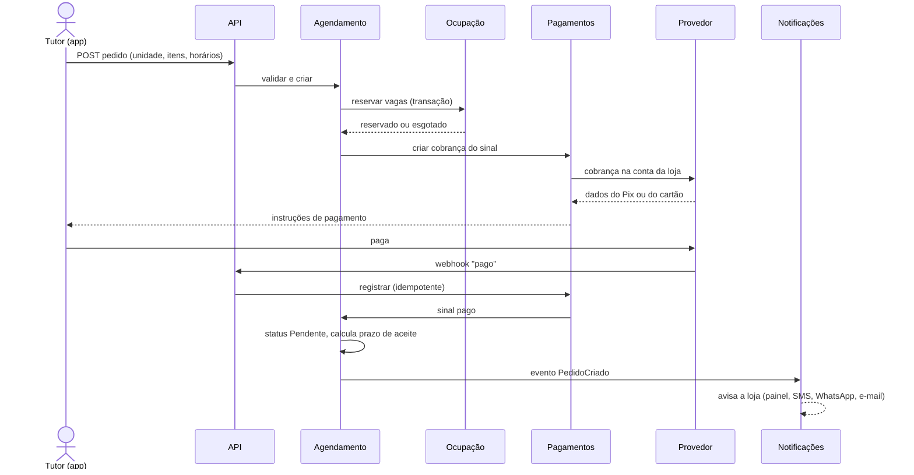
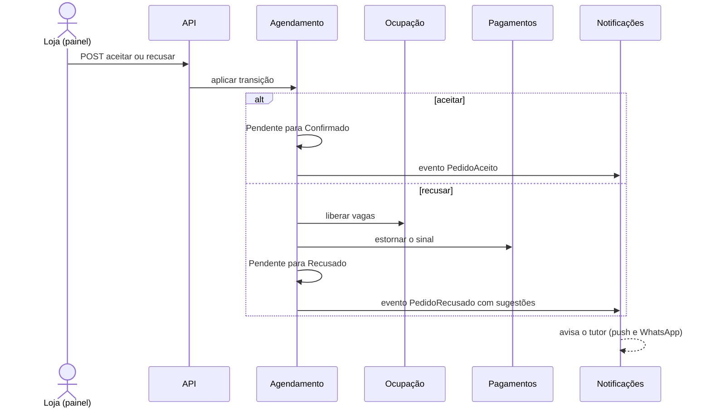
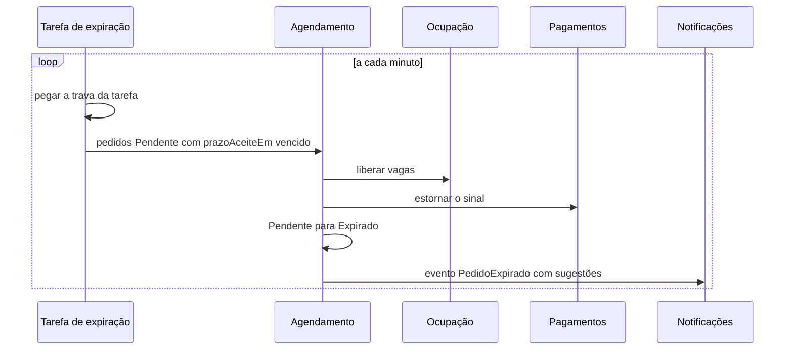
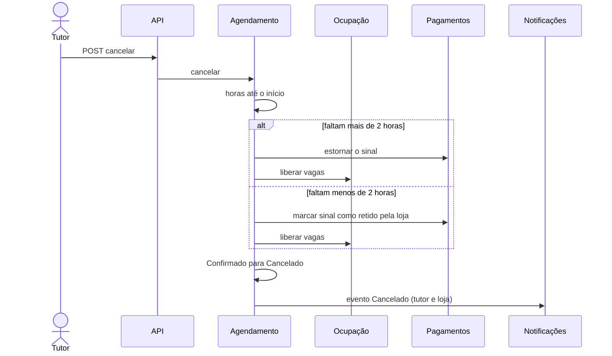
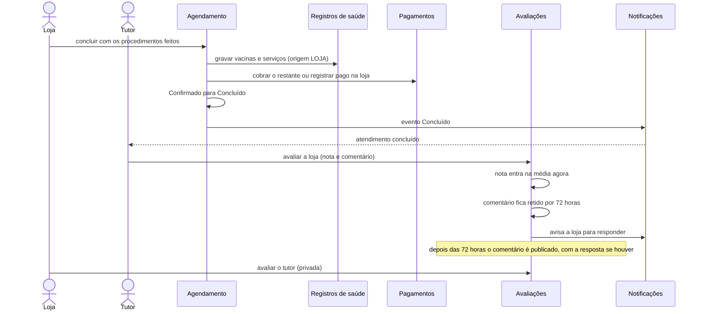
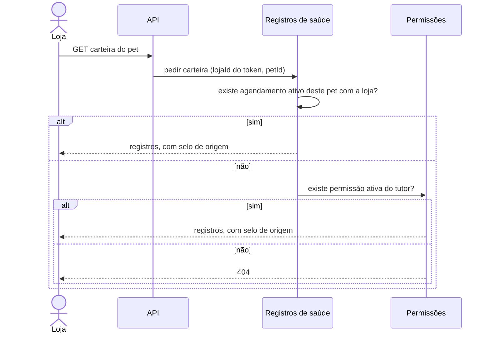

# Diagramas de engenharia (v2.0)

> **Sistema-alvo.** Estados e sequências do agendamento e do pagamento, a partir das regras RN-40 a RN-55 do [Documento Negocial v2.0](../01-negocio/Documento-Negocial-v2.0.md). Os campos citados estão no [Modelo de dados](Modelo-de-Dados-v2.0.md); os módulos, na [Arquitetura-alvo](Arquitetura-Alvo-v2.0.md#3-componentes-do-backend).
>
> É **proposta**. Esta versão acrescenta ao ciclo do Documento Negocial o estado **Aguardando pagamento**, que depende da resposta do PO à pergunta P-07 (o sinal é cobrado ao pedir).

---

## 1. Estados do agendamento

### Transições

| De | Para | Quem | Condição | Vaga | Sinal (50%) |
|---|---|---|---|---|---|
| (novo) | Aguardando pagamento | Tutor | Pedido válido: horário com capacidade livre (RN-41), cartão de garantia cadastrado (RN-50), loja aprovada e em dia (RN-17) | Reservada por tempo curto | Cobrança criada |
| Aguardando pagamento | Pendente | Sistema | Webhook confirma o sinal | Mantida | Pago |
| Aguardando pagamento | Abandonado | Sistema | Tempo para pagar acabou (15 minutos, proposta) | Liberada | Cobrança cancelada |
| Pendente | Confirmado | Loja | Dentro do prazo de aceite | Mantida | Pago |
| Pendente | Recusado | Loja | Em qualquer momento do prazo | Liberada | **Devolvido** (RN-45) |
| Pendente | Expirado | Sistema | Prazo de aceite venceu (RN-43) | Liberada | **Devolvido** (RN-44) |
| Pendente | Cancelado | Tutor | Antes da resposta da loja | Liberada | Devolvido |
| Confirmado | Cancelado | Tutor | Faltam **mais** de 2 h para o horário (RN-46) | Liberada | **Devolvido** |
| Confirmado | Cancelado | Tutor | Faltam **menos** de 2 h (RN-46) | Liberada | **Retido pela loja** |
| Confirmado | Cancelado | Loja | Qualquer momento | Liberada | **Devolvido** (RN-45) |
| Confirmado | Falta | Loja | Depois do horário marcado (RN-47) | Já consumida | **Retido pela loja** |
| Confirmado | Concluído | Loja | Depois do atendimento; exige os registros do que foi feito (RN-48) | Já consumida | Abatido do total |

Regras de integridade:
- Toda transição grava uma linha em `historico` (de, para, quem, quando, motivo).
- Estados finais (Concluído, Falta, Cancelado, Recusado, Expirado, Abandonado) não mudam mais.
- **Remarcar** (RN-46) ainda não está no desenho: depende da pergunta P-08.
- O prazo de aceite é calculado na criação do pedido (RN-43) e guardado em `prazoAceiteEm`.

---

## 2. Estados do pagamento do sinal

`RetidoPelaLoja` é o `pagamentos.desfecho = RETIDO_PELA_LOJA` do modelo de dados: o pagamento continua pago e a loja simplesmente fica com o valor. O restante (RN-52) é outro pagamento, do tipo `RESTANTE`, cobrado depois do atendimento, ou registrado pela loja como `NA_LOJA`.

---

## 3. Sequências

### 3.1 Pedir o horário e pagar o sinal

Se as vagas esgotarem entre a busca do tutor e o pedido, a API devolve o erro de horário indisponível e o app mostra horários próximos.

### 3.2 A loja aceita ou recusa

### 3.3 O prazo de aceite vence

Antes do vencimento, a tarefa de aviso (a cada 5 minutos) manda um lembrete à loja.

### 3.4 O tutor cancela

### 3.5 Atendimento concluído, restante e avaliação

A avaliação do tutor pela loja nunca aparece para outras lojas; elas só veem os indicadores (`concluidos`, `faltas`, `notaMedia`) de RN-63.

### 3.6 A loja vê a carteira de vacinas

Quando a loja não tem acesso, a resposta é "não encontrado", e não "proibido", para não revelar que o pet existe.

---

## 4. O que ficou fora

- Fluxo de cadastro e verificação da loja (RN-03) e de recuperação de senha.
- Cobrança da mensalidade e inadimplência (RN-17).
- Exportação e exclusão de dados (RNF-06, RNF-07).

Entram no contrato da API v2.0 e nos diagramas de sequência dele, que são o próximo documento.
