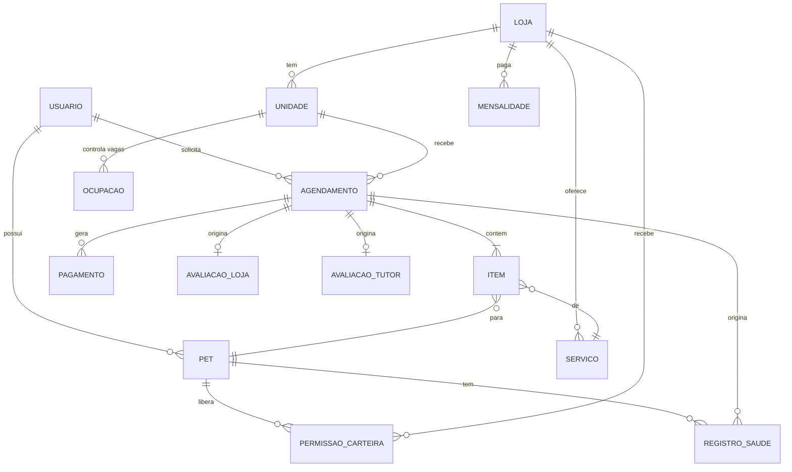

# Modelo de dados (v2.0)

> **Sistema-alvo**: MongoDB com Panache Kotlin ([ADR-006](../08-analise-tecnica/adrs.md#adr-006-flutter-na-web-e-no-mobile-e-kotlin-no-backend-quarkus)), isolamento por loja conforme o [ADR-008](../08-analise-tecnica/adrs.md#adr-008-isolamento-entre-lojas-multi-tenancy) e regras do [Documento Negocial v2.0](../01-negocio/Documento-Negocial-v2.0.md). O modelo do código atual está na [Arquitetura v1.0](Arquitetura-v1.0.md).
>
> É **proposta**: nada foi implementado. Os diagramas de estados e de sequência estão em [Diagramas-de-Engenharia-v2.0](Diagramas-de-Engenharia-v2.0.md).

---

## 1. Princípios

| Princípio | Como fica |
|---|---|
| Dinheiro | Inteiro em **centavos** (`Long`), sempre em reais. Nunca `Double` |
| Datas | Instante em **UTC** (`Instant`). A tela converte para America/Sao_Paulo |
| Identificadores | `ObjectId` do MongoDB; o CNPJ e o e-mail têm índice único próprio |
| Tenant | Todo dado de loja tem `lojaId` e é lido por repositório que exige `lojaId` (ADR-008). Dados do tutor não têm `lojaId` |
| Fotografia no pedido | O agendamento guarda nome e preço do serviço **no momento do pedido**, para a loja poder mudar o catálogo sem alterar o passado |
| Embutir ou referenciar | Embute o que nasce e morre com o dono e é lido junto (itens do agendamento, membros da loja); referencia o que tem vida própria (pets, pagamentos, avaliações) |
| Exclusão | O tutor pode pedir exclusão (RNF-06): os documentos dele são apagados, exceto os que a lei manda reter (seção 6) |

---

## 2. Visão geral



`ITEM` fica **embutido** no agendamento; `MEMBRO` fica embutido na loja. As demais entidades são coleções.

---

## 3. Coleções

Na coluna **Tenant**, `lojaId` quer dizer que o documento pertence a uma loja; `tutor` quer dizer que pertence a um tutor; `global` quer dizer que não pertence a nenhum dos dois.

### 3.1 Identidade e tutor

| Coleção | Tenant | Campos principais |
|---|---|---|
| `usuarios` | global | `email` (único), `senhaHash?`, `googleSub?`, `emailConfirmadoEm?`, `nome`, `telefone`, `cpf?`, `perfilTutor?` (veja abaixo), `criadoEm`, `excluidoEm?` |
| `pets` | tutor | `tutorId`, `nome`, `especie`, `raca?`, `porte`, `nascimento?`, `excluidoEm?` |
| `registros_saude` | tutor | `petId`, `tutorId`, `tipo` (VACINA, BANHO, TOSA, CONSULTA, OUTRO), `nome`, `data`, `proximaDose?`, `origem` (LOJA ou TUTOR), `verificado`, `lojaId?`, `agendamentoId?`, `profissional?` (`nome`, `crmv?`), `comprovanteId?`, `observacao?` |
| `permissoes_carteira` | tutor | `petId`, `tutorId`, `lojaId`, `concedidaEm`, `revogadaEm?` |

`perfilTutor` embutido em `usuarios`: `cartaoGarantia?` (`tokenProvedor`, `bandeira`, `final`), `preferenciasAviso` (push e WhatsApp), `indicadores` (`concluidos`, `faltas`, `notaMedia`; veja RN-63).

Regras de acesso:
- `registros_saude` com `origem = LOJA` tem `verificado = true`, o `profissional` e não pode ser editado pelo tutor. `origem = TUTOR` é sempre `verificado = false` e pode ter comprovante (RN-21). Um registro nunca sobrescreve o outro.
- A loja lê a carteira de um pet se **(a)** há agendamento ativo ou em andamento daquele pet com ela, ou **(b)** existe `permissoes_carteira` sem `revogadaEm` (RN-22, RN-23). O serviço de aplicação confere isso; a loja nunca consulta `registros_saude` direto.

### 3.2 Loja

| Coleção | Tenant | Campos principais |
|---|---|---|
| `lojas` | `lojaId` = `_id` | `cnpj` (único), `razaoSocial`, `nomeFantasia`, `statusCadastro` (AGUARDANDO_EMAIL, EM_REVISAO, APROVADA, SUSPENSA), `verificacao` (`situacaoReceita`, `cnaes`, `consultadoEm`), `assinatura` (`situacao`: EM_DIA ou EM_ATRASO, `proximoVencimento`), `contaRecebedora` (`provedor`, `contaId`, `statusKyc`), `membros[]` (`usuarioId`, `papel`), `canaisAviso` (painel, SMS, WhatsApp, e-mail, cada um com liga/desliga e destino), `googleAgenda?`, `notaMedia`, `totalAvaliacoes` |
| `unidades` | `lojaId` | `nome`, `endereco`, `localizacao` (ponto GeoJSON), `telefone`, `horarioFuncionamento[]` (`diaSemana`, `abre`, `fecha`), `raioTaxiKm?`, `capacidade` (por tipo de serviço, RN-13), `veterinarios[]` (`nome`, `crmv`; RN-14), `ativa` |
| `servicos` | `lojaId` | `tipo` (BANHO, TOSA, VACINA, CONSULTA, TAXI_PET), `nome`, `duracaoMinutos`, `precos[]` (`porte?`, `valorCentavos`), `especies[]`, `unidadeIds[]`, `ativo` |
| `ocupacao` | `lojaId` | `unidadeId`, `tipo`, `inicio` (começo do intervalo), `capacidade`, `ocupados`. Um documento por unidade, tipo de serviço e intervalo (seção 5) |
| `mensalidades` | `lojaId` | `competencia` (AAAA-MM), `valorCentavos`, `status` (A_VENCER, PAGA, EM_ATRASO), `vencimento`, `provedorCobrancaId`. Cobrada na conta do PetCare, não na da loja |

O papel do membro (`papel`) existe para o login por funcionário no futuro (RN-05). No MVP há um membro por loja.

### 3.3 Agendamento, pagamento e avaliação

| Coleção | Tenant | Campos principais |
|---|---|---|
| `agendamentos` | `lojaId` | `unidadeId`, `tutorId`, `status`, `itens[]` (`petId`, `servicoId`, `nomeServico`, `precoCentavos`, `inicio`, `fim`), `inicio`, `fim`, `totalCentavos`, `sinalCentavos`, `prazoAceiteEm?`, `tutorSnapshot` (`nome`, `telefone`), `notaFiscal?` (`arquivoId`, `tipo`), `historico[]` (`de`, `para`, `em`, `porUsuarioId?`, `motivo?`), `versao` |
| `pagamentos` | `lojaId` | `agendamentoId`, `tutorId`, `tipo` (SINAL ou RESTANTE), `valorCentavos`, `metodo` (CARTAO, PIX, DEBITO, NA_LOJA), `status` (CRIADO, PENDENTE, PAGO, FALHOU, ESTORNADO), `desfecho?` (DEVOLVIDO ou RETIDO_PELA_LOJA), `provedor`, `provedorCobrancaId`, `estornos[]`, `pagadorSnapshot`, `retencaoAte` |
| `avaliacoes_loja` | `lojaId` | `agendamentoId` (único), `tutorId`, `unidadeId`, `nota`, `comentario?`, `status` (RETIDO, PUBLICADO, REMOVIDO), `publicarEm`, `resposta?` (`texto`, `em`), `denuncias[]` |
| `avaliacoes_tutor` | `lojaId` | `agendamentoId` (único), `tutorId`, `nota`, `comentario?`. **Não é pública** (RN-63) |

Observações:
- `agendamentos.historico` é a **trilha de auditoria**: toda mudança de status guarda quem fez e quando.
- `agendamentos.versao` serve para detectar duas alterações simultâneas (otimismo): a gravação só vale se a versão ainda for a lida.
- Um pagamento `SINAL` com `desfecho = RETIDO_PELA_LOJA` é a multa (RN-46, RN-47). `DEVOLVIDO` vem de recusa, expiração, cancelamento da loja ou cancelamento do tutor com mais de 2 h de antecedência.
- Pagamento `NA_LOJA` é o restante pago direto na loja; quem registra é a loja (RN-52).
- A média e o total de avaliações ficam em `lojas` (`notaMedia`, `totalAvaliacoes`) para a busca não precisar agregar toda vez; são atualizados quando uma nota entra.

### 3.4 Infraestrutura

| Coleção | Tenant | Para que serve |
|---|---|---|
| `eventos` | global | *Outbox*: evento de negócio gravado antes de virar mensagem (`tipo`, `dados`, `lojaId?`, `criadoEm`, `processadoEm?`, `tentativas`) |
| `notificacoes` | global | Uma mensagem por destinatário e canal (`destinatario`, `canal`, `modelo`, `status`, `agendarPara`, `enviadaEm?`, `tentativas`, `idNoProvedor?`) |
| `webhooks_recebidos` | global | `provedor`, `eventoId` (único): garante que um webhook repetido não seja processado duas vezes |
| `trava_tarefas` | global | `nome`, `ate`, `dono`: uma instância por vez roda cada tarefa agendada |
| `solicitacoes_lgpd` | tutor | `usuarioId`, `tipo` (EXPORTACAO ou EXCLUSAO), `status`, `pedidoEm`, `concluidaEm?` |
| `fs.files` e `fs.chunks` (GridFS) | tutor ou `lojaId` | Comprovantes de vacina e arquivos de NFS-e (PDF e XML), com `donoId` e `retencaoAte` nos metadados |

---

## 4. Índices

| Coleção | Índice | Motivo |
|---|---|---|
| `usuarios` | `email` único; `googleSub` único (parcial) | Login |
| `lojas` | `cnpj` único; `statusCadastro` | Cadastro e fila de revisão |
| `unidades` | `lojaId`; `localizacao` (2dsphere) | "Perto de mim" (RN-30) |
| `servicos` | `lojaId + ativo`; `tipo` | Catálogo e filtro |
| `pets` | `tutorId` | Lista do tutor |
| `registros_saude` | `petId + data` (decrescente) | Carteira e histórico |
| `permissoes_carteira` | `petId + lojaId` único (parcial: sem `revogadaEm`) | Uma permissão ativa por loja |
| `ocupacao` | `unidadeId + tipo + inicio` único | Reserva atômica |
| `agendamentos` | `lojaId + unidadeId + inicio`; `lojaId + status + prazoAceiteEm`; `tutorId + inicio` | Agenda da loja, pedidos a vencer, lista do tutor |
| `pagamentos` | `agendamentoId`; `provedor + provedorCobrancaId` único | Conciliação e webhooks |
| `avaliacoes_loja` | `lojaId + status + publicarEm`; `agendamentoId` único | Publicação após 72 h e página da loja |
| `avaliacoes_tutor` | `tutorId + lojaId`; `agendamentoId` único | Indicadores do tutor |
| `eventos` | `processadoEm` (parcial: sem valor) | Fila de eventos a processar |
| `notificacoes` | `status + agendarPara` | Envio |
| `webhooks_recebidos` | `provedor + eventoId` único | Idempotência |
| `trava_tarefas` | `nome` único | Trava |

Os índices de coleções de loja começam por `lojaId` (ADR-008). Os índices de `ocupacao`, `pagamentos` e `webhooks_recebidos` são únicos de propósito: a **unicidade é o que garante a regra** quando duas requisições chegam juntas.

---

## 5. Consistência

### 5.1 Reserva atômica de vaga

Cada intervalo de **30 minutos** (proposta, pergunta P-09) de cada tipo de serviço de cada unidade tem um documento em `ocupacao`:

```
unidadeId, tipo, inicio, capacidade, ocupados
```

Reservar um intervalo é uma operação só:

```
findOneAndUpdate(
  { unidadeId, tipo, inicio, ocupados: { $lt: capacidade } },
  { $inc: { ocupados: 1 } }
)
```

Se não volta documento, o horário esgotou. Uma tarefa agendada cria esses documentos com antecedência (60 dias é uma proposta), a partir do horário de funcionamento e da capacidade da unidade, e de novo quando a loja muda um deles. O índice único evita documentos duplicados. Um serviço que dura vários intervalos reserva **todos numa transação**, para não sobrar reserva pela metade. Liberar uma vaga (recusa, expiração, cancelamento) é o `$inc: -1` correspondente, também na mesma transação do novo status.

Se a loja mudar a capacidade, os intervalos futuros são atualizados; ocupação já existente nunca fica abaixo do que já foi reservado.

### 5.2 Transações

O MongoDB do Atlas roda em *replica set*, então há transações. Usar para: criar o agendamento junto com a reserva de vagas; mudar o status junto com liberar vagas; marcar a conclusão junto com gravar `registros_saude`. Fora disso, operação de um documento só.

### 5.3 Idempotência

- Webhooks: gravar `webhooks_recebidos` (índice único) antes de processar; se já existe, ignorar.
- Criação de cobrança: enviar ao provedor uma chave de idempotência derivada do agendamento e do tipo de pagamento.
- Tarefas: cada execução pega a trava de `trava_tarefas`.

---

## 6. Retenção e LGPD

| Dado | Regra |
|---|---|
| Tutor, pets, carteira, permissões | Apagados na exclusão (RNF-06) |
| Pagamentos e notas fiscais | Retidos por **5 anos** (RNF-08). `pagamentos.pagadorSnapshot` guarda o mínimo (nome e CPF, se informado) para que o registro continue válido depois de apagar o `usuarios` |
| Agendamentos | Ficam enquanto a loja precisa deles para a contabilidade; o dado do tutor no pedido (`tutorSnapshot`) é reduzido ao mínimo na exclusão |
| Avaliações do tutor sobre a loja | Apagadas na exclusão; as notas já somadas em `lojas.notaMedia` ficam |
| Exportação (RNF-07) | Pets, carteira de vacinas e histórico em arquivo para baixar |

Os pontos acima precisam de **revisão jurídica** junto com a política de privacidade (RNF-11).

---

## 7. Perguntas ao PO

Registradas como pendências P-07 a P-12 do [Documento Negocial](../01-negocio/Documento-Negocial-v2.0.md#pendências).

| # | Pergunta | Proposta de engenharia |
|---|---|---|
| P-07 | **Quando o sinal é cobrado?** A RN-51 diz "na confirmação", mas as RN-44 e RN-45 devolvem o sinal quando a loja recusa ou o prazo vence, o que só faz sentido se ele já foi pago ao pedir | Cobrar o sinal **ao pedir**, e a loja só vê o pedido depois do pagamento. Recusa e expiração devolvem. Isso acrescenta o estado `AguardandoPagamento` (veja os diagramas) |
| P-08 | **Remarcar** exige novo aceite da loja? | Remarcar mantém o sinal e volta o pedido para `Pendente`, com novo prazo de aceite |
| P-09 | Qual o tamanho do intervalo da agenda? | 30 minutos |
| P-10 | Um pedido com vários pets ou serviços é aceito **inteiro** ou item a item? E os serviços ocorrem em sequência ou ao mesmo tempo? | Aceite do pedido inteiro; cada item escolhe seu horário e ocupa a capacidade do tipo naquele horário |
| P-11 | Até quando a loja pode concluir ou marcar falta num pedido já vencido? O que acontece se ela esquecer? | Lembrar a loja por aviso; sem conclusão automática, para não reter sinal sem confirmação humana |
| P-12 | Quanto tempo o tutor tem para avaliar depois do atendimento? | 30 dias |
