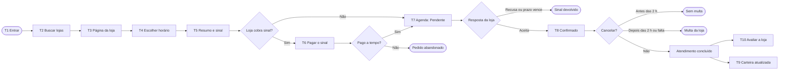
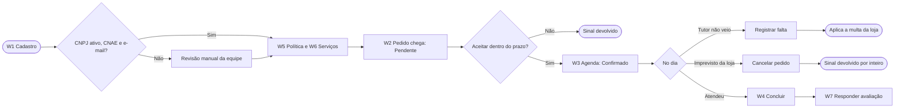

# Telas e fluxos (v1.0)

> **Sistema-alvo.** Wireframes de baixa fidelidade do app do tutor (Android) e do painel web da loja, e os fluxos entre as telas. Servem para validar o que cada tela mostra e o que ela chama na API, **não** definem identidade visual, cores finais nem tipografia. A identidade está em [Identidade visual v1.0](Identidade-Visual-v1.0.md).
>
> Regras: [Documento Negocial v2.0](../01-negocio/Documento-Negocial-v2.0.md). Rotas: [Contrato da API v2.0](../02-arquitetura-tecnica/Contrato-API-v2.0.md). É **proposta**, sujeita às respostas do PO às pendências P-07 a P-15.

---

## 1. Onde estão os desenhos

| O que | Onde |
|---|---|
| 17 telas (10 do tutor, 7 da loja) e os componentes básicos | [Figma: PetCare, telas e fluxos](https://www.figma.com/design/78LTEyl9XQWaYjjJqWfQsm), páginas **Tutor (Android)** e **Loja (web)** |
| Fluxos do tutor e da loja | [FigJam: fluxos](https://www.figma.com/board/dFzAbKu55ADTEJNAvKT4es) |

Os arquivos do Figma foram criados na área de rascunhos do PO e precisam ser movidos para o projeto da equipe. O Figma é o desenho; **este documento é a referência versionada**: quando uma tela mudar, este texto muda no mesmo PR.

---

## 2. Tela por tela

### 2.1 App do tutor (Android, 390 × 844)

| Tela | O que mostra | Regras | Rotas |
|---|---|---|---|
| **T1 Entrar** | E-mail e senha, entrar com Google, esqueci a senha, criar conta | RN-04 | `/auth/login`, `/auth/google`, `/auth/esqueci-senha` |
| **T2 Buscar lojas** | Campo de busca, filtros (perto de mim, serviço, espécie, preço, nota), lista com nota, distância e preço inicial | RN-30 | `GET /lojas` |
| **T3 Página da loja** | Fotos, nota, endereço, telefone, **política de cancelamento (sinal e multa)**, catálogo | RN-31, RN-58 | `GET /lojas/{id}`, `GET /lojas/{id}/avaliacoes` |
| **T4 Escolher horário** | Pet, serviço, data, horários livres de 30 min | RN-40, RN-41 | `GET /unidades/{id}/disponibilidade` |
| **T5 Resumo e sinal** | Itens, total, sinal, restante, **multa em reais**, forma de pagamento, prazo de resposta da loja | RN-43, RN-51, RN-56 a RN-58 | `POST /tutor/agendamentos` |
| **T6 Pagar sinal no Pix** | QR Code, Pix copia e cola, contagem regressiva de 15 min | RN-51 | `GET /tutor/agendamentos/{id}` (atualiza o estado) |
| **T7 Agenda** | Abas Próximos e Histórico, cartões com selo de estado | RN-42 | `GET /tutor/agendamentos` |
| **T8 Detalhe e cancelamento** | Estado, itens, pagamentos, **o que acontece se cancelar agora e depois das 2 h**, remarcar, cancelar, nota fiscal | RN-46, RN-55, RN-57 | `GET /tutor/agendamentos/{id}`, `POST .../cancelar`, `POST .../remarcar` |
| **T9 Carteira de vacinas** | Registros com selo **Verificado pela loja** ou **Informado por você**, próximo reforço, lojas com permissão, adicionar registro | RN-21 a RN-24 | `GET /tutor/pets/{id}/carteira`, `POST .../registros`, `PUT/DELETE .../permissoes/{lojaId}` |
| **T10 Avaliar atendimento** | Nota de 1 a 5, comentário opcional, aviso das 72 h | RN-60, RN-61 | `POST /tutor/agendamentos/{id}/avaliacao` |

### 2.2 Painel web da loja (1280 × 800)

| Tela | O que mostra | Regras | Rotas |
|---|---|---|---|
| **W1 Cadastro da loja** | CNPJ, razão social, e-mail, telefone, senha, primeira unidade, como funciona a aprovação | RN-03, RN-10, RN-11 | `POST /auth/cadastro-loja` |
| **W2 Pedidos** | Pendentes com **prazo de aceite**, tutor com indicadores (faltas e nota), sinal, aceitar e recusar | RN-42 a RN-45, RN-63 | `GET /loja/agendamentos`, `POST .../aceitar`, `POST .../recusar`, SSE `/loja/eventos` |
| **W3 Agenda do dia** | Grade por hora e tipo de serviço, com a capacidade; pendente também ocupa a vaga | RN-13, RN-42 | `GET /loja/agenda` |
| **W4 Detalhe e conclusão** | Tutor, pet, pagamento, registros do que foi feito (vacina com CRMV), restante pelo app ou na loja, nota fiscal, concluir, registrar falta, cancelar | RN-47, RN-48, RN-52, RN-55, RN-57 | `POST .../concluir`, `.../registrar-falta`, `.../cancelar`, `.../nota-fiscal` |
| **W5 Política de cancelamento** | Sinal (%) e multa (%), exemplo calculado, aviso de que só vale para pedidos novos | RN-56 a RN-58 | `GET/PUT /loja/politica-cancelamento` |
| **W6 Serviços e capacidade** | Catálogo (tipo, duração, preço por porte, unidades) e capacidade por tipo de serviço | RN-12 a RN-15 | `/loja/servicos`, `PUT /loja/unidades/{id}` |
| **W7 Avaliações** | Avaliações com tempo restante para responder, responder, denunciar | RN-61, RN-62 | `GET /loja/avaliacoes`, `POST .../resposta`, `POST .../denuncia` |

---

## 3. Fluxos

### 3.1 Tutor

### 3.2 Loja

---

## 4. Princípios das telas

| Princípio | Aplicação |
|---|---|
| Mostrar o dinheiro antes de pedir | A política (sinal e multa) aparece na página da loja (T3) e, em reais, no resumo (T5) e no detalhe (T8). O tutor nunca descobre a multa depois |
| Dizer o prazo | O tutor vê quanto a loja tem para responder; a loja vê quanto falta para aceitar (W2) |
| Selos de origem | Na carteira, o selo "Verificado pela loja" ou "Informado por você" é sempre visível (RN-21) |
| Um canal de verdade | Estados do pedido mudam por evento do servidor (SSE no painel, push no app); a tela busca de novo, não calcula sozinha |
| Estados vazios e erros | Toda lista tem estado vazio com próxima ação, e todo erro mostra a mensagem pelo `codigo` da API ([Contrato, seção 7](../02-arquitetura-tecnica/Contrato-API-v2.0.md#7-erros)) |
| Acessibilidade | Contraste mínimo AA, alvos de toque de 48 dp, fonte escalável, estado nunca só por cor (o selo tem texto) |
| Só português e reais | RNF-03; valores sempre `R$ 0,00`, datas `dd/mm/aaaa` |

---

## 5. Telas que faltam desenhar

| Tela | Para quê |
|---|---|
| Cadastro de tutor, confirmação de e-mail e recuperação de senha | RN-04 |
| Lista de pets e cadastro de pet | RN-20 |
| Cartão de garantia (cadastro, troca e remoção) | RN-50, RN-57 |
| Notificações dentro do app e preferências de aviso | RN-70 |
| Perfil, exportação e exclusão de dados (LGPD) | RNF-06, RNF-07 |
| Remarcação | Depende de P-08 |
| Unidades e horário de funcionamento (loja) | RN-10, RN-11 |
| Conta recebedora e cadastro no provedor (loja) | RN-53 |
| Mensalidade e inadimplência (loja) | RN-17 |
| Canais de aviso e Google Agenda (loja) | RN-71, RN-72 |
| Estados vazios, de carregamento e de erro | Todas |
| Versão web do tutor (telas largas) | RNF-04 |

Essas telas seguem o mesmo padrão das já desenhadas e entram numa v1.1 deste documento.

---

## 6. Decisões que faltam

| # | Decisão | Onde |
|---|---|---|
| 1 | ~~Identidade visual: nome, logotipo, cores e tipografia~~ Decidida em 10/11/2026: nome Pertim, direção Bairro | [Identidade visual v1.0](Identidade-Visual-v1.0.md) |
| 2 | Sistema de design em Flutter (Material 3 ou próprio) | ADR do app Flutter |
| 3 | Mapa na busca (qual provedor de mapas e seu custo) | A decidir, com a estimativa de custo |
| 4 | Vitrine pública da loja fora do app, para buscadores | Arquitetura-alvo, seção 9 |
