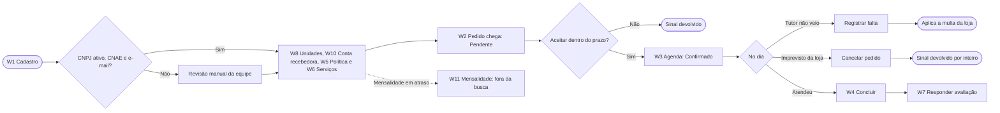

# Telas e fluxos (v1.1)

> **Sistema-alvo.** Wireframes de baixa fidelidade do app do tutor (Android) e do painel web da loja, e os fluxos entre as telas. Servem para validar o que cada tela mostra e o que ela chama na API, **não** definem identidade visual, cores finais nem tipografia. A identidade está em [Identidade visual v1.0](Identidade-Visual-v1.0.md).
>
> Regras: [Documento Negocial v2.0](../01-negocio/Documento-Negocial-v2.0.md). Rotas: [Contrato da API v2.0](../02-arquitetura-tecnica/Contrato-API-v2.0.md). É **proposta**, sujeita às respostas do PO às pendências P-07 a P-15.

---

## 1. Onde estão os desenhos

| O que | Onde |
|---|---|
| 17 telas da v1.0 (10 do tutor, 7 da loja) e os componentes básicos, já com a identidade Pertim | [Figma: telas e fluxos](https://www.figma.com/design/78LTEyl9XQWaYjjJqWfQsm), páginas **Tutor (Android)** e **Loja (web)** |
| As 49 telas da v1.1 (as 17 acima e as 32 novas), componentes, cores claro e escuro e os dois fluxos | Projeto **Pertim – telas e fluxos** no Open Design, no computador do PO (8 páginas: identidade, tutor, tutor T11 a T25, tutor web, loja, loja W8 a W12, estados, fluxos) |
| Fluxos do tutor e da loja | [FigJam: fluxos](https://www.figma.com/board/dFzAbKu55ADTEJNAvKT4es) |

Os arquivos do Figma foram criados na área de rascunhos do PO e precisam ser movidos para o projeto da equipe. O Figma e o Open Design são o desenho; **este documento é a referência versionada**: quando uma tela mudar, este texto muda no mesmo PR.

---

## 2. Tela por tela

### 2.1 App do tutor (Android, 390 × 844)

| Tela | O que mostra | Regras | Rotas |
|---|---|---|---|
| **T1 Entrar** | E-mail e senha, entrar com Google, esqueci a senha, criar conta | RN-04 | `/auth/login`, `/auth/google`, `/auth/esqueci-senha` |
| **T2 Buscar lojas** | Campo de busca, filtros (perto de mim, serviço, espécie, preço, nota), lista com nota, distância e preço inicial | RN-30 | `GET /lojas` |
| **T3 Página da loja** | Fotos, nota, endereço, telefone, **política de cancelamento (sinal e multa)**, catálogo | RN-31, RN-58 | `GET /lojas/{id}`, `GET /lojas/{id}/avaliacoes` |
| **T4 Escolher horário** | Pet, serviço, data, horários livres de 30 min | RN-40, RN-41 | `GET /unidades/{id}/disponibilidade` |
| **T5 Resumo e sinal** | Itens, total, sinal, restante, **multa em reais**, forma de pagamento, prazo de resposta da loja | RN-43, RN-51, RN-56 a RN-58 | `POST /tutor/agendamentos` |
| **T6 Pagar sinal no Pix** | QR Code, Pix copia e cola, contagem regressiva de 15 min | RN-51 | `GET /tutor/agendamentos/{id}` (atualiza o estado) |
| **T7 Agenda** | Abas Próximos e Histórico, cartões com selo de estado | RN-42 | `GET /tutor/agendamentos` |
| **T8 Detalhe e cancelamento** | Estado, itens, pagamentos, **o que acontece se cancelar agora e a partir de 2 h antes do horário**, remarcar, cancelar, nota fiscal | RN-46, RN-55, RN-57 | `GET /tutor/agendamentos/{id}`, `POST .../cancelar`, `POST .../remarcar` |
| **T9 Carteira de vacinas** | Registros com selo **Verificado pela loja** ou **Informado por você**, próximo reforço, lojas com permissão, adicionar registro | RN-21 a RN-24 | `GET /tutor/pets/{id}/carteira`, `POST .../registros`, `PUT/DELETE .../permissoes/{lojaId}` |
| **T10 Avaliar atendimento** | Nota de 1 a 5, comentário opcional, aviso das 72 h | RN-60, RN-61 | `POST /tutor/agendamentos/{id}/avaliacao` |

### 2.2 Painel web da loja (1280 × 800)

| Tela | O que mostra | Regras | Rotas |
|---|---|---|---|
| **W1 Cadastro da loja** | CNPJ, razão social, e-mail, telefone, senha, primeira unidade, como funciona a aprovação | RN-03, RN-10, RN-11 | `POST /auth/cadastro-loja` |
| **W2 Pedidos** | Pendentes com **prazo de aceite**, tutor com indicadores (faltas e nota), sinal, aceitar e recusar | RN-42 a RN-45, RN-63 | `GET /loja/agendamentos`, `POST .../aceitar`, `POST .../recusar`, SSE `/loja/eventos` |
| **W3 Agenda do dia** | Grade por hora e tipo de serviço, com a capacidade; pendente também ocupa a vaga | RN-13, RN-42 | `GET /loja/agenda` |
| **W4 Detalhe e conclusão** | Tutor, pet, pagamento, registros do que foi feito (vacina com CRMV), restante pelo app ou na loja, nota fiscal, concluir, registrar falta, cancelar | RN-47, RN-48, RN-52, RN-55, RN-57 | `POST .../concluir`, `.../registrar-falta`, `.../cancelar`, `.../nota-fiscal` |
| **W5 Política de cancelamento** | Sinal (%) e multa (%), exemplo calculado, aviso de que só vale para pedidos novos | RN-56 a RN-58 | `GET/PUT /loja/politica-cancelamento` |
| **W6 Serviços e capacidade** | Catálogo (tipo, duração, preço por porte, unidades) e capacidade por tipo de serviço | RN-12 a RN-15 | `/loja/servicos`, `PUT /loja/unidades/{id}` |
| **W7 Avaliações** | Avaliações com tempo restante para responder, responder, denunciar | RN-61, RN-62 | `GET /loja/avaliacoes`, `POST .../resposta`, `POST .../denuncia` |

### 2.3 App do tutor: telas da v1.1 (390 × 844)

| Tela | O que mostra | Regras | Rotas |
|---|---|---|---|
| **T11 Criar conta** | Google ou e-mail, nome, celular, senha, aceite dos termos | RN-04 | `POST /auth/cadastro-tutor` |
| **T12 Confirmar e-mail** | Código de 6 números, reenviar com contagem, trocar e-mail; busca liberada, pedido só com e-mail confirmado | RN-04 | `POST /auth/confirmar-email`, `/auth/reenviar-confirmacao` |
| **T13 Esqueci a senha** | E-mail e resposta neutra ("se existir conta…") | RN-04 | `POST /auth/esqueci-senha` (sempre 202) |
| **T14 Senha nova** | Senha nova e repetição, erro no campo, aviso de saída dos outros aparelhos | RN-04 | `POST /auth/redefinir-senha` |
| **T15 Meus pets** | Lista com espécie, raça, porte, idade e próximo lembrete; pet com agendamento ativo não pode ser removido | RN-20, RN-24 | `GET /tutor/pets` |
| **T16 Cadastrar pet** | Nome, espécie, raça, porte (com faixa de peso), nascimento | RN-20 | `POST /tutor/pets` |
| **T17 Cartão de garantia** | Bandeira e final, para que serve, exemplo da diferença cobrada, trocar e remover | RN-50, RN-57 | `GET /tutor/cartao-garantia` |
| **T18 Cadastrar ou trocar cartão** | Formulário do provedor (só crédito); o app guarda só bandeira e final | RN-50, RNF-10 | `POST /tutor/cartao-garantia` |
| **T19 Remover cartão** | Só aparece se houver outro cartão cadastrado; com um cartão só, a tela mostra "Cadastre outro cartão antes de remover este" e o botão para cadastrar | RN-50, RN-74 | `DELETE /tutor/cartao-garantia` |
| **T20 Notificações** | Avisos do app por dia, com não lidos | RN-70 | `GET /eu/notificacoes` |
| **T21 Preferências de aviso** | Push e WhatsApp liga e desliga, alerta se desligar os dois | RN-70 | `PUT /eu/preferencias-aviso` |
| **T22 Conta** | Dados, cartão, avisos, privacidade, ajuda, sair | — | `PUT /eu`, `POST /auth/sair` |
| **T23 Privacidade e dados** | Baixar dados (arquivo pronto e validade) e excluir conta | RNF-06, RNF-07 | `POST /eu/exportacao`, `GET /eu/exportacao/{id}` |
| **T24 Excluir conta** | O que apaga, o que a lei obriga a guardar, agendamentos que serão cancelados, confirmação com senha | RNF-06 | `POST /eu/exclusao` |
| **T25 Remarcar** | Novo dia e horário, sinal mantido, pedido volta para "Aguardando a loja". Se a loja recusar, o pedido fica no horário antigo e o T8 oferece "Cancelar sem multa" | RN-46, RN-73, P-08 | `POST /tutor/agendamentos/{id}/remarcar` |

### 2.4 Tutor na web (1280 de largura)

| Tela | O que mostra | Regras | Rotas |
|---|---|---|---|
| **TW1 Buscar lojas** | Filtros e lista à esquerda, mapa à direita | RNF-04, RN-30 | `GET /lojas` |
| **TW2 Página da loja** | Política, catálogo e painel lateral para escolher horário | RNF-04, RN-31, RN-58 | `GET /lojas/{id}`, `/unidades/{id}/disponibilidade` |
| **TW3 Meus agendamentos** | Lista e detalhe lado a lado, com o que acontece se cancelar | RNF-04, RN-46 | `GET /tutor/agendamentos` |

As demais telas do tutor na web reaproveitam as do app numa coluna central.

### 2.5 Painel da loja: telas da v1.1 (1280 × 800)

| Tela | O que mostra | Regras | Rotas |
|---|---|---|---|
| **W8 Unidades** | Unidades com horário, raio do táxi pet e veterinários | RN-10, RN-11 | `GET /loja/unidades` |
| **W9 Editar unidade** | Endereço, táxi pet e raio, veterinários com CRMV, horário por dia da semana; mudar o horário recalcula os horários livres futuros | RN-11, RN-13, RN-14 | `PUT /loja/unidades/{id}`, `/veterinarios` |
| **W10 Conta recebedora** | Etapas do cadastro no provedor e link para continuar | RN-53 | `GET/POST /loja/conta-recebedora` |
| **W11 Mensalidade e inadimplência** | Faixa de atraso (fora da busca, sem pedidos novos), meses com situação, gerar Pix | RN-17 | `GET /loja/mensalidades`, `POST .../cobranca` |
| **W12 Canais de aviso e Google Agenda** | Painel, WhatsApp, SMS e e-mail liga e desliga; Google Agenda conectada nas duas vias: pedidos confirmados vão para o Google, e compromissos do Google bloqueiam esses horários no app | RN-71, RN-72, RN-75 | `PUT /loja`, `POST/DELETE /loja/google-agenda` |

A W5 passou a dizer que o sinal vai de 0 a 100% (RN-56) e que, se a multa puder passar do sinal, o tutor precisa de cartão de garantia.

### 2.6 Estados vazios, de carregamento e de erro

| Tela | O que mostra | Origem |
|---|---|---|
| **E1 Busca sem resultado** | Filtros ativos, aumentar o raio ou limpar filtros | `GET /lojas` |
| **E2 Agenda vazia** | O que vai aparecer e "Buscar lojas" | `GET /tutor/agendamentos` |
| **E3 Carregando a busca** | Esqueleto dos cartões | `GET /lojas` |
| **E4 Sem conexão** | Agenda salva com horário, o que precisa de rede, tentar de novo | Todas |
| **E5 Horário acabou de ser reservado** | Aviso e horário riscado | `HORARIO_INDISPONIVEL` |
| **E6 Falta cartão de garantia** | Folha no resumo com multa e sinal em reais | `CARTAO_GARANTIA_OBRIGATORIO` |
| **E7 Erro no servidor** | "Nada foi alterado", tentar de novo, código para o suporte | `ERRO_INTERNO` (`idRequisicao`) |
| **E8 Pedidos vazio e tempo real caiu** | Faixa "reconectando" e estado vazio | SSE `/loja/eventos` |
| **E9 Cadastro em revisão** | Faixa de revisão manual e primeiro serviço vazio | RN-03, `LOJA_NAO_APROVADA` |

A página de estados no Open Design também traz a mensagem de tela e a ação oferecida para cada código de erro da [seção 7 do Contrato](../02-arquitetura-tecnica/Contrato-API-v2.0.md#7-erros).

---

## 3. Fluxos

### 3.1 Tutor

```mermaid
flowchart LR
  criar["T11 Criar conta"] --> confirma["T12 Confirmar e-mail"] --> entrar
  entrar(["T1 Entrar"]) --> esqueci["T13 Esqueci a senha"] --> nova["T14 Senha nova"] --> entrar
  entrar --> buscar["T2 Buscar lojas"] --> loja["T3 Página da loja"] --> horario["T4 Escolher horário"] --> resumo["T5 Resumo e sinal"]
  resumo -->|"Multa maior que o sinal e sem cartão"| cartao["T18 Cadastrar cartão"] --> resumo
  resumo --> sinal{"Loja cobra sinal?"}
  sinal -->|"Sim"| pix["T6 Pagar o sinal"]
  sinal -->|"Não"| agenda["T7 Agenda: Pendente"]
  pix --> pago{"Pago a tempo?"}
  pago -->|"Não"| aband(["Pedido abandonado"])
  pago -->|"Sim"| agenda
  agenda --> resp{"Resposta da loja"}
  resp -->|"Recusa ou prazo vence"| exp(["Sinal devolvido"])
  resp -->|"Aceita"| conf["T8 Confirmado"]
  conf --> cancel{"Cancelar?"}
  cancel -->|"Até 2 h antes do horário"| semMulta(["Sem multa"])
  cancel -->|"Menos de 2 h antes ou falta"| multa(["Multa da loja"])
  conf --> remarc["T25 Remarcar"] --> agenda
  cancel -->|"Não"| atend["Atendimento concluído"]
  atend --> aval["T10 Avaliar a loja"]
  atend --> cart["T9 Carteira atualizada"]
```

### 3.2 Loja

---

## 4. Princípios das telas

| Princípio | Aplicação |
|---|---|
| Mostrar o dinheiro antes de pedir | A política (sinal e multa) aparece na página da loja (T3) e, em reais, no resumo (T5) e no detalhe (T8). O tutor nunca descobre a multa depois |
| Dizer o prazo | O tutor vê quanto a loja tem para responder; a loja vê quanto falta para aceitar (W2) |
| Selos de origem | Na carteira, o selo "Verificado pela loja" ou "Informado por você" é sempre visível (RN-21) |
| Um canal de verdade | Estados do pedido mudam por evento do servidor (SSE no painel, push no app); a tela busca de novo, não calcula sozinha |
| Estados vazios e erros | Toda lista tem estado vazio com próxima ação, e todo erro mostra a mensagem pelo `codigo` da API ([Contrato, seção 7](../02-arquitetura-tecnica/Contrato-API-v2.0.md#7-erros)) |
| Acessibilidade | Contraste mínimo AA, alvos de toque de 48 dp, fonte escalável, estado nunca só por cor (o selo tem texto) |
| Só português e reais | RNF-03; valores sempre `R$ 0,00`, datas `dd/mm/aaaa` |

---

## 5. Pontos das telas decididos pelo PO

As suposições da v1.1 foram respondidas pelo PO em 10/11/2026.

| # | Ponto | Decisão |
|---|---|---|
| 1 | Remarcação que a loja não aceita | A loja decide. Se recusar, o pedido fica no horário antigo e o tutor pode cancelar sem penalidade (RN-73) |
| 2 | Remover o cartão de garantia | Só com outro cartão cadastrado (RN-74) |
| 3 | Sentido da integração com o Google Agenda | Nas duas vias: o app envia os pedidos, e compromissos do Google deixam o horário indisponível no app (RN-75) |
| 4 | Preços nas telas | Os preços dos serviços, inclusive o táxi pet, são definidos pela loja (RN-12, RN-15); os valores nas telas são só ilustração. A mensalidade segue em aberto (P-05) |
| 5 | Prazos de exemplo | Link do provedor válido por 24 h e arquivo de exportação por 7 dias continuam como proposta de engenharia |
| 6 | Mapa na busca | Marcador de lugar até a biblioteca ser escolhida |

Os desenhos do Open Design ainda mostram as suposições antigas nas telas T19, T25 e W12 e precisam ser ajustados.

Ainda não desenhadas: as demais telas do tutor em tela larga (seção 2.4).

---

## 6. Decisões que faltam

| # | Decisão | Onde |
|---|---|---|
| 1 | ~~Identidade visual: nome, logotipo, cores e tipografia~~ Decidida em 10/11/2026: nome Pertim, direção Bairro | [Identidade visual v1.0](Identidade-Visual-v1.0.md) |
| 2 | Sistema de design em Flutter (Material 3 ou próprio) | ADR do app Flutter |
| 3 | ~~Mapa na busca~~: decidido pelo PO em 10/11/2026, mapa gratuito (tiles abertos). Falta escolher a biblioteca no ADR do app | ADR-009 |
| 4 | Vitrine pública da loja fora do app, para buscadores | Arquitetura-alvo, seção 9 |
